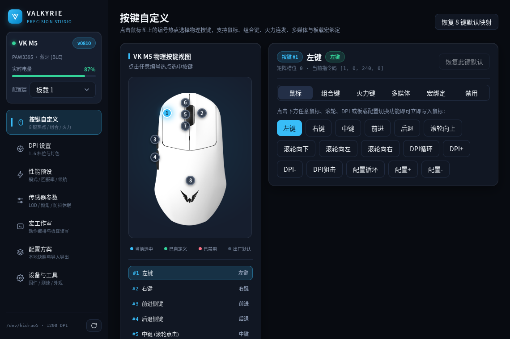
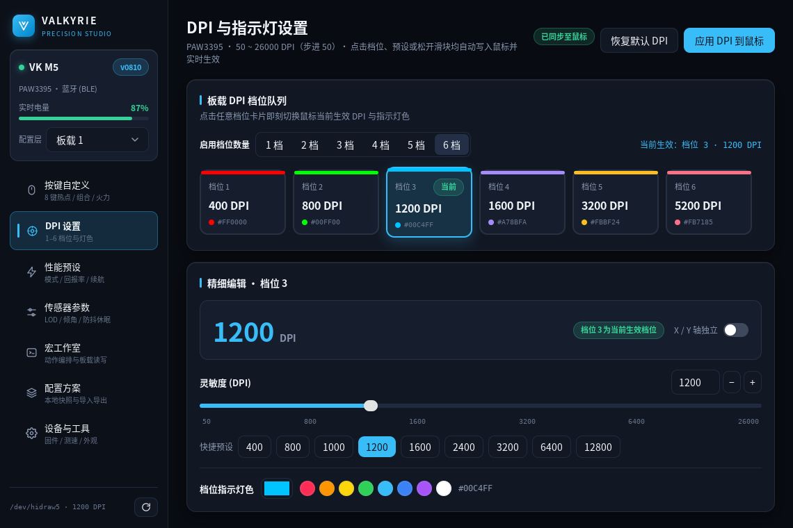
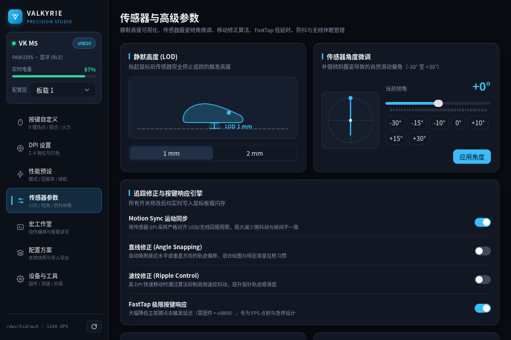
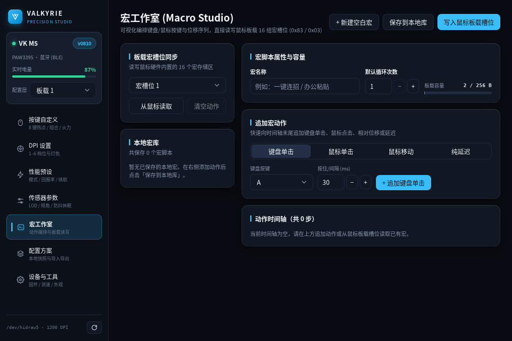
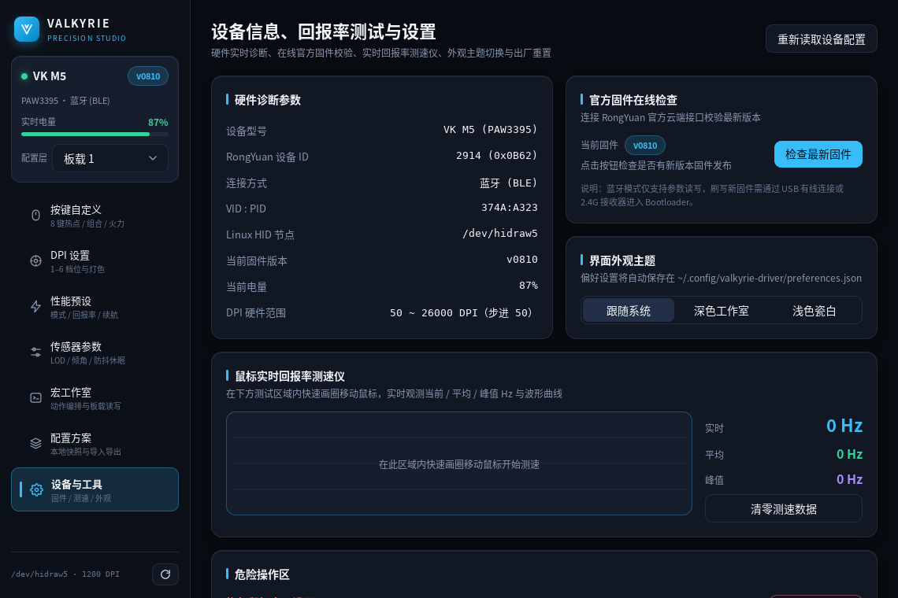

# Valkyrie Driver for Linux (`valkyrie-driver-linux`)

> **语言 / Language**：**简体中文** | [English](README_EN.md)

[](LICENSE)
[](https://github.com/Xunflash/valkyrie-driver-linux/releases)
[](https://go.dev/)
[%20%7C%20Windows%20(amd64)-10b981.svg)](#下载预编译版本)

一个专为 Linux 与 Windows 打造的 **瓦尔基里 (Valkyrie) 鼠标原生轻量驱动**（已在 **VK M5 / PAW3395** 真机上通过蓝牙 BLE 完整实测）。

使用 **纯 Go (`CGO_ENABLED=0`) + [`egoist/mygo`](https://github.com/egoist/mygo) 原生 GPU UI** 编写，在 Linux 上直连 `/dev/hidraw*`、在 Windows 上直连原生 Win32 HID (`hid.dll` / `setupapi.dll`)：**无需 Wine、无需 Electron / Chromium / WebView、无需浏览器 WebHID 授权弹窗**，单可执行文件仅约 **12 MB**，完整复刻 Windows 官方驱动核心功能。

---

## 界面预览

### 按键自定义（交互式 8 键热点视图 + 6 大功能分类）


### DPI 与指示灯设置（1~6 档动态档位 + 非线性滑块 + 实时写回校验）


### 性能预设与回报率（四档模式 + 官方续航预估 + 7 档回报率 + 真 8K）


### 传感器与高级参数（LOD 激光视图 + 极坐标角度罗盘 + FastTap / 防抖 / 休眠）


<details>
<summary>查看更多页面截图（宏工作室 / 设备诊断与回报率测速仪）</summary>




</details>

---

## 核心特性

- **极简轻量原生架构**：单文件纯 Go 二进制（无 CGO、无 WebView / Chromium 多进程），支持 Wayland / X11 与 `arm64` / `amd64`，内置 **深色工作室 (Obsidian)** 与 **浅色瓷白 (Porcelain)** 双主题。
- **三模直连 Linux `hidraw`**：
  - **蓝牙 (BLE)**：UsagePage `0xFF55`、ReportID `6`（66 字节），内置写入节流、读重试与写后闪存校验。
  - **2.4G 无线接收器**：UsagePage `0xFFFF` Feature Report（支持 `0xF7` 状态查询、`0xF6` 鼠标通道选择与 `0xFC` 响应读取）。
  - **USB 有线**：UsagePage `0xFFFF` `HIDIOCSFEATURE` / `HIDIOCGFEATURE` 直连。
- **完整复刻 Windows 版 VK M5 (`CommonMSCH585`) 全部功能**：
  1. **按键自定义**：左键、右键、前进、后退、中键、滚轮向上、滚轮向下、底部 DPI 键全部 8 槽位可视化热点选择；支持 **鼠标功能 / 键盘单键与组合键 / 硬件火力连发键 / 24 种多媒体与系统快捷指令 / 板载宏绑定 / 禁用按键**。
  2. **DPI 设置**：动态调整 **1~6 档** 启用数量、分段非线性电竞滑块、X/Y 轴独立调节、每档独立 RGB 指示灯拾色器；点选档位卡片、预设或松开滑块即时写入鼠标，并自动回读校验确保落盘。
  3. **性能预设**：**办公 / 性能 / 游戏 / 狂暴** 四档模式卡片与官方续航预估、125 ~ 8000 Hz 七档回报率、20000 FPS 竞技扫描、2.4G 均衡 8K / 满血真 8K (`0x0D`)。
  4. **传感器参数**：静默高度 LOD（`1 mm / 2 mm`，PAW3950 支持 `0.7 / 1 / 2 mm`）、`-30° ~ +30°` 传感器握姿角度微调、Motion Sync、直线修正、波纹修正、FastTap 按键低延时、微动与滚轮防抖、2.4G / 蓝牙独立休眠策略。
  5. **宏工作室**：读写鼠标板载 16 组宏槽位（`0x83` / `0x03`）、256 字节实时容量条、键盘/鼠标/位移/延迟动作编排与本地宏库管理。
  6. **本地配置方案**：将鼠标完整快照保存到 `~/.config/valkyrie-driver/profiles.json`，支持一键写回、重命名与 JSON 导入/导出。
  7. **设备诊断与工具**：实时电量、在线检查 RongYuan 官方最新固件版本、内置 **鼠标实时回报率测速仪**（实时/平均/峰值 Hz + 波形图）、二次确认恢复出厂设置。
- **命令行只读诊断模式**：支持 `--status`、`--json`、`--check-fw`，可零窗口快速查询电量与板载参数。

---

## 支持设备

基于 RongYuan `CommonMSCH585` 协议（VID `0x374A` / `0x3151`）：

| 型号 | 传感器 | 设备 ID | 最大 DPI | 状态 |
| --- | --- | --- | --- | --- |
| **Valkyrie VK M5** | PAW3395 | `2914` | 26000 | 真机蓝牙完整实测通过 |
| **Valkyrie VK M5 Lite** | PAW3311 | `3090` | 24000 | 协议参数已内置 |
| **Valkyrie VK M5 PRO** | PAW3950 | `3395` / `3572` | 42000 | 协议参数已内置 |
| **Valkyrie VK M5 EVO** | PAW3950 | `3855` | 42000 | 协议参数已内置 |

---

## 系统依赖

- **编译依赖**：Go `1.27.3+`（无需 GCC / CGO）
- **运行依赖**：Linux 桌面环境自带的 `libgtk-4`、`libpango`、`libGL` / `libepoxy`（主流 GNOME / KDE 桌面默认已包含）

---

## 下载预编译版本

前往 [**GitHub Releases**](https://github.com/Xunflash/valkyrie-driver-linux/releases) 直接下载由 GitHub Actions 自动构建的二进制包（均附带 `SHA256SUMS.txt`）：

| 平台 | 架构 | 压缩包 | 说明 |
| --- | --- | --- | --- |
| **Windows** | `x86_64` (`amd64`) | `valkyrie-driver-v*-windows-amd64.zip` | 解压双击 `valkyrie-driver.exe` 即可运行 |
| **Linux** | `x86_64` (`amd64`) | `valkyrie-driver-v*-linux-amd64.tar.gz` | 含二进制、图标与 `packaging/99-valkyrie-hid.rules` |
| **Linux (ARM)** | `arm64` (`aarch64`) | `valkyrie-driver-v*-linux-arm64.tar.gz` | 适用于树莓派 / ARM 笔记本 / 工作站 |

---

## 从源码安装与构建

### 方式一：一键脚本安装（推荐）

```bash
git clone https://github.com/Xunflash/valkyrie-driver-linux.git
cd valkyrie-driver-linux
chmod +x packaging/install.sh
./packaging/install.sh
```

### 方式二：使用 Makefile 分步安装

```bash
# 1. 编译纯 Go 单文件二进制
make build

# 2. 安装可执行文件、图标与桌面快捷方式到 ~/.local/
make install

# 3. 安装 udev 权限规则（允许普通用户读写蓝牙 / 2.4G / USB hidraw 设备）
make install-udev
```

> **提示**：安装 udev 规则后，如仍提示无权限访问 `/dev/hidraw*`，请重新插拔接收器或断开重连一次鼠标蓝牙。

---

## 命令行用法

```bash
# 启动图形界面
valkyrie-driver

# 终端只读查看当前鼠标电量、DPI、传感器参数与按键映射
valkyrie-driver --status

# 同时联网检查官方最新固件版本
valkyrie-driver --status --check-fw

# 以 JSON 格式输出（便于接入 Waybar / 状态栏电量组件）
valkyrie-driver --status --json
```

---

## 开发与测试

```bash
# 运行全部协议单测、存储单测与 MyGo 无头 UI 测试（无需图形界面）
make test

# （可选）连接真实蓝牙鼠标后运行非破坏性等幂写回校验
make test-live
```

### 目录结构

```text
.
├── main.go                 # 入口与 CLI (--status / --json / --check-fw)
├── backend.go              # 硬件后端抽象与 Linux hidraw 实现
├── storage.go              # ~/.config/valkyrie-driver 本地配置、宏库与偏好存储
├── ui_app.go               # 应用主框架、侧边栏、异步串行 HID 工作队列
├── ui_theme.go             # Obsidian / Porcelain 双主题系统与矢量图标
├── ui_page_*.go            # 7 大功能页面（按键 / DPI / 性能 / 传感器 / 宏 / 配置 / 设备）
├── hid/
│   ├── descriptor.go       # 通用 Report Descriptor 解析、蓝牙分包与 USB/2.4G Feature 传输层
│   ├── hidraw_linux.go     # Linux 纯 Go /sys/class/hidraw 扫描与三模传输层
│   ├── hid_windows.go      # Windows 纯 Go Win32 HID (hid.dll / setupapi.dll) 三模传输层
│   ├── protocol.go         # CommonMSCH585 指令编解码与 Bit7 校验
│   ├── keymap.go           # 鼠标 / 组合键 / 火力键 / 多媒体 / 宏绑定双向编解码
│   ├── macro.go            # 256 字节板载宏打包/解包与 0x03/0x83 分包读写
│   └── types.go            # 型号能力表、热点坐标与默认 16×4 按键矩阵
├── .github/workflows/      # GitHub Actions 自动测试与多平台 Release 发布流
├── assets/                 # 嵌入图标与鼠标俯视图
├── packaging/              # udev 规则、.desktop 快捷方式与一键安装脚本
└── docs/screenshots/       # 界面预览截图
```

---

## 免责声明

本项目为社区开源的非官方 Linux 驱动工具，与 **瓦尔基里 (Valkyrie)** 及 **RongYuan (融远)** 官方无任何隶属或合作关系。软件中引用的设备名称、商标与外观图示归各自权利人所有。

修改硬件参数（尤其是恢复出厂设置）具有一定风险，本项目按 MIT 协议「按原样」提供；固件刷写功能暂未集成（蓝牙模式亦不支持刷写固件），如需升级固件请使用官方工具在有线模式下操作。

## License

[MIT License](LICENSE) © 2026 Xunflash
