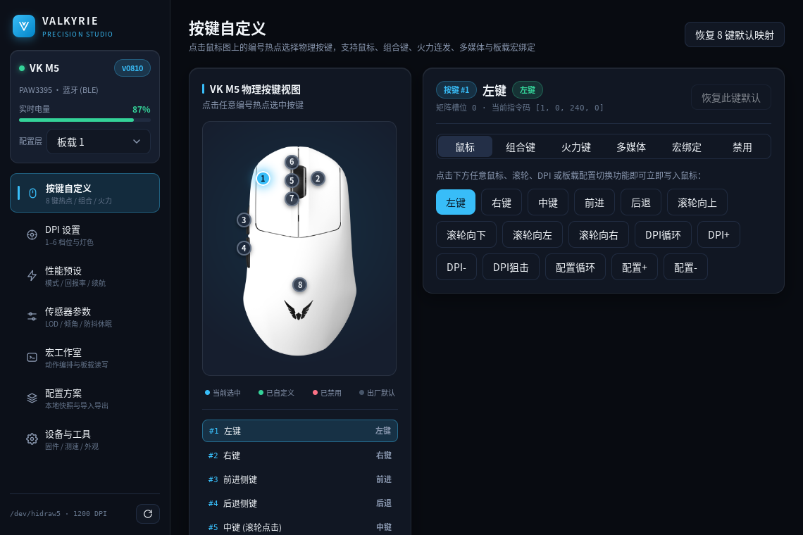
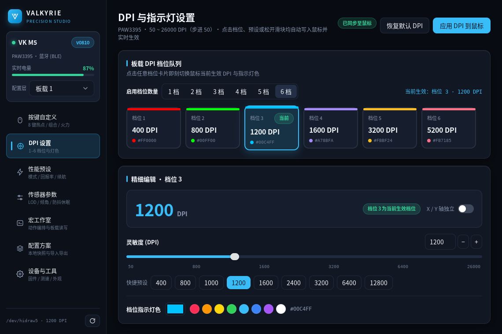
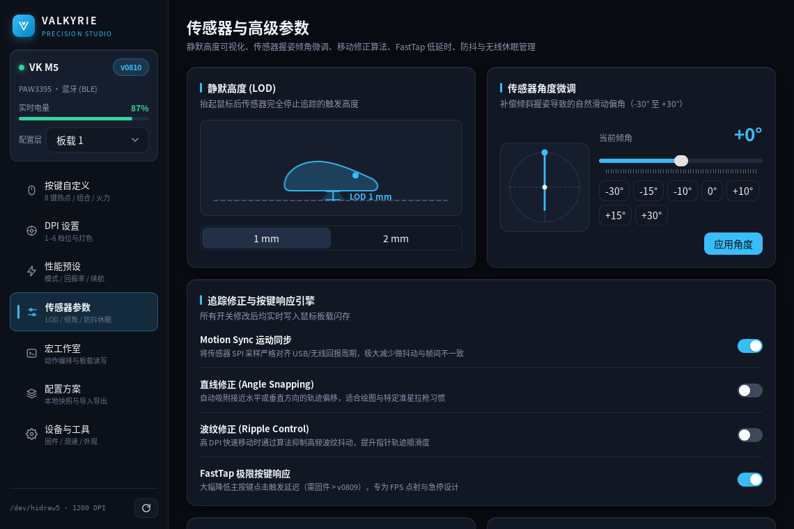

# Valkyrie Driver for Linux (`valkyrie-driver-linux`)

> **Language**: [简体中文](README.md) | **English**

[](LICENSE)
[](https://github.com/Xunflash/valkyrie-driver-linux/releases)
[](https://go.dev/)
[%20%7C%20Windows%20(amd64)-10b981.svg)](#downloads)

A lightweight, native mouse configuration studio for **Valkyrie (RongYuan `CommonMSCH585`)** gaming mice on **Linux & Windows** — tested end-to-end on real **Valkyrie VK M5 (PAW3395)** hardware over Bluetooth (BLE).

Built with **pure Go (`CGO_ENABLED=0`)** and [**`egoist/mygo`**](https://github.com/egoist/mygo) native GPU UI, talking directly to Linux `/dev/hidraw*` and Windows Win32 HID (`hid.dll` / `setupapi.dll`). No Wine, no Electron/Chromium/WebView, and no WebHID permission prompts — compiles down to a single **~12 MB** binary with full official-driver feature parity.

---

## Screenshots

| Key Customization | DPI & LED Studio |
| :---: | :---: |
|  |  |

| Performance Presets & Endurance | Sensor, LOD & Angle Compass |
| :---: | :---: |
|  |  |

---

## Features

- **Native Tri-Mode Linux `hidraw` Transport**: Supports **Bluetooth (BLE `0xFF55`, ReportID 6)**, **2.4G Wireless Dongle (`0xF7`/`0xF6`/`0xFC`)**, and **USB Wired (`0xFFFF` Feature Reports)** in pure Go (`ppoll` + `HIDIOCSFEATURE`/`HIDIOCGFEATURE`).
- **Interactive 8-Button Key Customization**: Official clickable VK M5 shell hotspots (Left, Right, Forward, Back, Middle, Scroll Up, Scroll Down, DPI) with Mouse actions, Keyboard Combos, Hardware Fire/Rapid-Click keys, 24 Multimedia/System shortcuts, Onboard Macro binding, and Disable.
- **Dynamic 1–6 Stage DPI Studio**: Instant click-to-switch stages, non-linear ergonomic DPI slider (`50–26000` / `42000`), independent X/Y axis toggle, per-stage RGB LED color picker, and post-write hardware readback verification.
- **Performance & Sensor Tuning**: Office / Performance / Gaming / Rage presets with battery-life estimation, 125–8000 Hz polling rate, 20000 FPS mode, 2.4G True 8K, visual LOD (`0.7 / 1 / 2 mm`), `-30° ~ +30°` sensor angle compass, Motion Sync, Angle Snapping, Ripple Control, FastTap low latency, debounce, and wireless sleep timers.
- **Macro Studio & Local Profiles**: Read/write all 16 onboard 256-byte macro slots (`0x83`/`0x03`), save full mouse snapshots locally (`~/.config/valkyrie-driver/`), and export/import JSON profiles.
- **Diagnostics & Built-in Tools**: Live battery telemetry, official online firmware version check, real-time **Mouse Polling Rate Tester** (live/avg/peak Hz waveform), Dark/Light/System themes, and CLI read-only status (`--status`, `--json`, `--check-fw`).

---

## Downloads

Prebuilt binaries for **Windows (x64)**, **Linux (x86_64)**, and **Linux ARM64** are automatically built via GitHub Actions on [**GitHub Releases**](https://github.com/Xunflash/valkyrie-driver-linux/releases):

- `valkyrie-driver-v*-windows-amd64.zip` — Extract and launch `valkyrie-driver.exe`
- `valkyrie-driver-v*-linux-amd64.tar.gz` — Includes binary, icon, desktop entry, and udev rules
- `valkyrie-driver-v*-linux-arm64.tar.gz` — Includes binary, icon, desktop entry, and udev rules

---

## Building from Source

### Prerequisites
- Build: Go `1.27.3+` (no CGO/GCC required)
- Runtime: standard Linux desktop GTK4 / Pango / OpenGL libraries (`libgtk-4`, `libpango`, `libepoxy`, `libGL`)

### Quick Install

```bash
git clone https://github.com/Xunflash/valkyrie-driver-linux.git
cd valkyrie-driver-linux
chmod +x packaging/install.sh
./packaging/install.sh
```

Or build manually with `make`:

```bash
make build
make install
make install-udev
```

### CLI Diagnostics

```bash
valkyrie-driver --status
valkyrie-driver --status --check-fw
valkyrie-driver --status --json
```

---

## Disclaimer

This is an unofficial, community-developed open-source Linux driver and is not affiliated with or endorsed by **Valkyrie** or **RongYuan**. Firmware flashing is intentionally not implemented; use the official vendor tool over wired USB for firmware upgrades.

## License

[MIT License](LICENSE) © 2026 Xunflash
